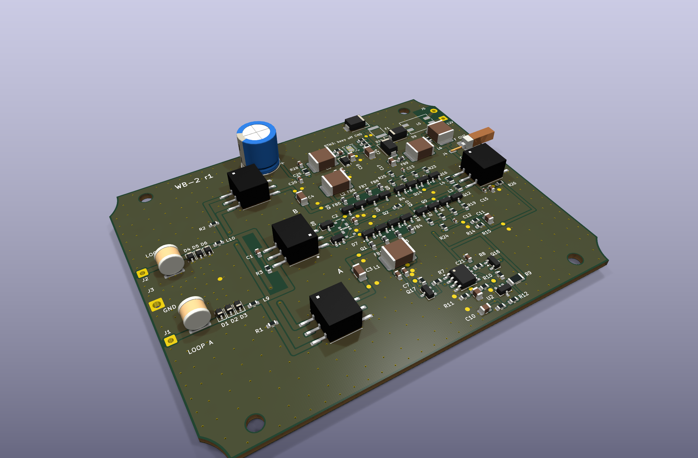
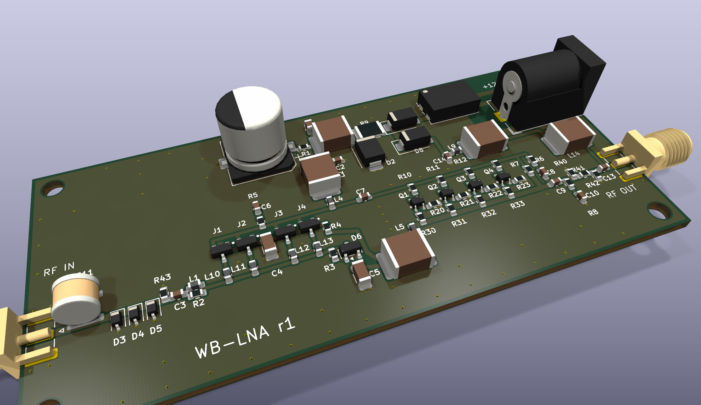
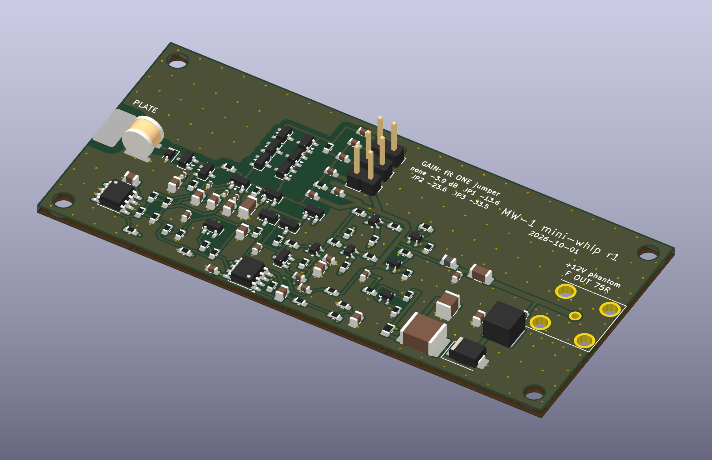
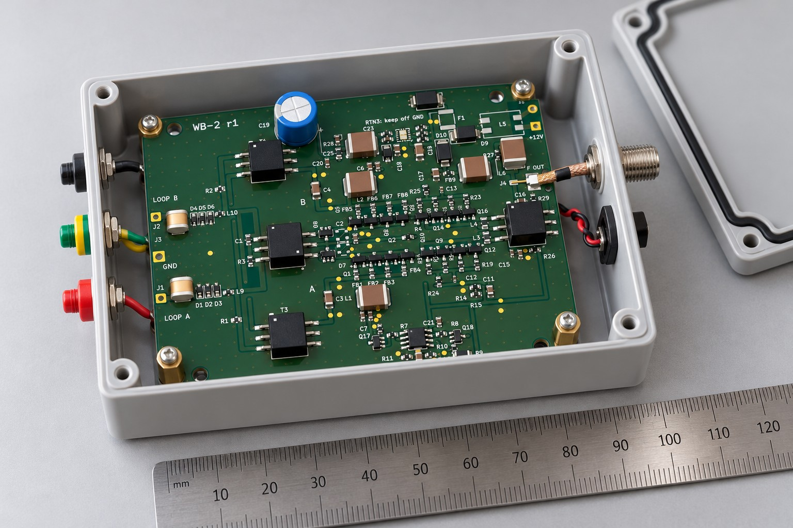
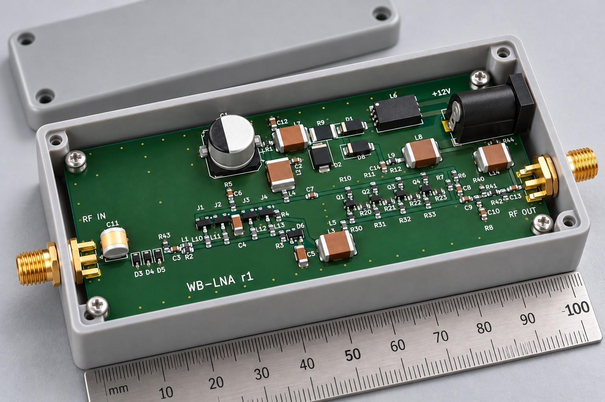
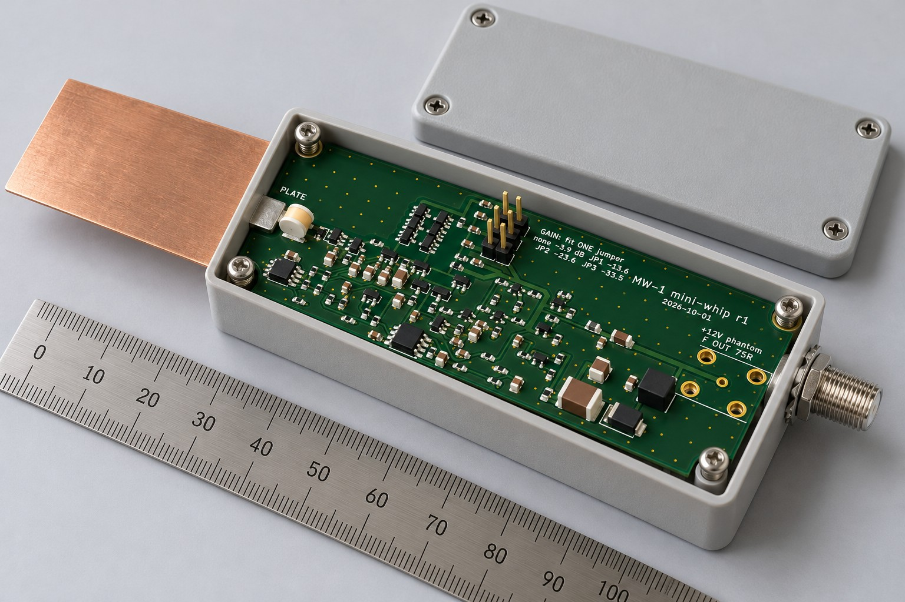

For the glory and the service of our God.

# HF active antennas

These are three open-hardware HF receive-antenna amplifiers. Each one ships with:
- an LTspice model you can simulate as delivered;
- a KiCad 10 board;
- JLCPCB-ready gerbers, BOM and pick-and-place;
- 3D renders and simulation plots.

All three use the Linear Systems **LSBF862** ultra-low-noise JFET at the input.

| | | |
|:---:|:---:|:---:|
|  |  |  |
| **[WB-2: zero-flux loop amplifier](wb2-loop-amplifier/)** | **[WB-LNA: loop preamplifier](wb-lna-loop-preamp/)** | **[MW-1: mini-whip E-field probe](mw1-mini-whip/)** |
| A balanced, transformer-feedback (zero-flux) amplifier for small receiving loops, Wellbrook ALA1530 class. 8 + 8 LSBF862, catalog Coilcraft transformers, 75 Ω F out. | A single-ended high-impedance preamp for a loop or any high-Z HF source. 4× LSBF862 common source → 4× NSVF4009 with shunt feedback, 50 Ω SMA. | A charge amplifier for a small capacitive plate (PA0RDT / PA3FWM class), built for linearity and spike survival. Jumper gain steps, 75 Ω F out, phantom power. |
| 0.1–30 MHz · 21.6 dB · NF 0.2–1.3 dB (50 Ω source) | 0.03–30 MHz · 24 dB · NF 0.8–1.1 dB | 9 kHz–30 MHz · OIP3 +47 dBm · OIP2 +73 dBm |
|  |  |  |

*Top row: KiCad 3D renders of the actual boards. Bottom row: AI-generated concept renders of the intended builds (ChatGPT image generation, from the KiCad renders and enclosure dimensions). They are not photographs; nothing has been built yet.*

## What is in each folder

| path | contents |
|---|---|
| `README.md` | the explanation, performance tables, plots and ordering notes |
| `images/` | 3D renders, copper plots, and the schematic as PNG and SVG |
| `ltspice/` | the `.asc` schematic plus every model library it needs. Open the `.asc` in LTspice and press Run; the `.lib` paths are relative. |
| `plots/` | simulation results |
| `jlcpcb/` | `*_gerbers_drill.zip` (upload this), the unzipped gerbers and drill files, `BOM_JLCPCB.csv` and `CPL_JLCPCB.csv` |
| `BOM.csv` | the full bill of materials, with manufacturer, MPN, footprint and status |
| `kicad/` | KiCad 10 board, project, custom footprint libraries and the DRC report |
| `*.step` | 3D board model for enclosure work |

## Status: read this before ordering
- **Simulation only.** Every performance figure here comes from LTspice. That includes nominal and tolerance corners, layout-parasitic models of the boards, and stability margins. **None of these boards has been built or measured yet.**
  - Treat the first boards as prototypes.
  - WB-2 has a first-board bring-up procedure in [`wb2-loop-amplifier/docs/BRINGUP.md`](wb2-loop-amplifier/docs/BRINGUP.md).
- **The LSBF862 is not stocked at LCSC.** Buy it from Linear Integrated Systems or a distributor, then hand-fit it or consign it to JLCPCB. The same applies to the Coilcraft transformers on WB-2.
- **No surge, ESD or lightning rating is claimed.** All three boards have protection networks, but none has been tested.
- **Check rotations in JLCPCB's placement preview.** KiCad and JLC disagree on the zero orientation of several packages (SOT-23, SOD-323, SC-82FL and others).
- **Model provenance:**
  - The LSBF862, NSVF4009 and MMBTH81 models are transcriptions of the manufacturers' published SPICE parameters, with LTspice syntax fixes noted in each file header.
  - The BC817-25 and 1N5819 come from LTspice's standard library.
  - The NSVF4015 model is a fit to its datasheet; onsemi publishes no model for it.
  - The protection parts, op-amps and the eFuse are behavioural.

## Tools
- [`tools/asc_render.py`](tools/asc_render.py) renders an LTspice `.asc` to PNG/SVG using LTspice's own symbol graphics. It needs LTspice installed for the `.asy` files. The schematic images were made with it.
- [`tools/net_compare.py`](tools/net_compare.py) compares an LTspice-generated `.net` against a reference SPICE netlist: element by element, value by value, with topology up to net renaming.
  - The WB-2 schematic is generated from the design's netlist and checked with it: 240 elements, 0 differences.
  - The AC response is identical to 1e-10 dB.

## License
Hardware design files, models and documentation are released under the **CERN Open Hardware Licence Version 2 – Permissive** ([`LICENSE`](LICENSE), SPDX `CERN-OHL-P-2.0`). They are provided as-is, without warranty; see sections 6–7 of the licence.
