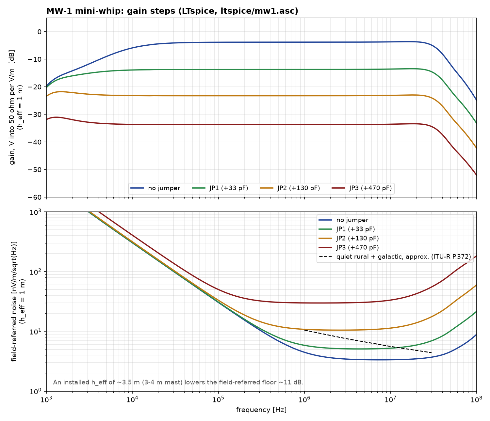
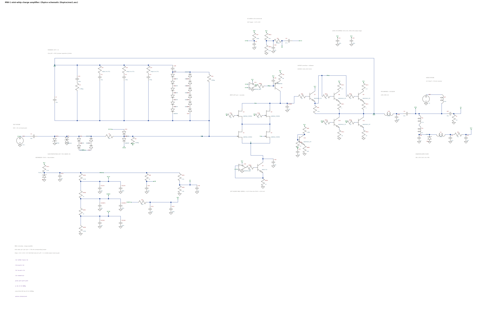

# MW-1: mini-whip E-field probe amplifier

*Concept render: AI-generated (ChatGPT image generation) from the KiCad renders and the enclosure dimensions, with a ruler for scale. It shows the intended build; it is **not** a photograph of a built unit.*

MW-1 is an active receiving antenna for 9 kHz – 30 MHz in the PA0RDT / PA3FWM / GigActiv class: a small capacitive plate on a mast, read by a low-noise amplifier.
- **Circuit:** a **charge amplifier** rather than the usual source follower. Gain is set by capacitance alone, so the gain steps are noiseless.
- **Design priorities:** linearity, overload margin and survival of nearby static and lightning spikes.
- **Plate:** 3 × 2 in (or a wire of similar size), about 10 pF.
- **Output and power:** 75 Ω F jack; +12 V phantom power up the coax.

## Performance
Simulated, coax-fed from a 12 V bias-T, so VCC at the board is 10.98 V at 103 mA. Field figures are referred to h_eff = 1 m.

| | 9 kHz | 100 kHz | 1 MHz | 7 MHz | 10 MHz | 30 MHz |
|---|---|---|---|---|---|---|
| Gain (V into 50 Ω per V/m) | −6.4 dB | −3.9 dB | −3.9 dB | −3.8 dB | −3.8 dB | −5.3 dB |
| Field noise (nV/m/√Hz) | | 30.5 | 4.5 | 3.4 | 3.4 | 3.8 |

- **OIP3** (7.0 / 7.1 MHz): **+47.3 dBm** at −3 dBm/tone; +44.3 dBm at +9 dBm/tone.
- **OIP2:** **+73.4 dBm**.
- **Output P1dB:** about +20 dBm.
- **FM band** (88–108 MHz): about −18 to −23 dB relative to 1 MHz.
- **Mains:** 50/60 Hz is about −110 dB.

**Installed height.** On a 3–4 m mast, h_eff is expected to be about 3.5 m. That lowers the field-referred noise about 3.5× (−11 dB), to roughly 1 nV/m/√Hz. That is 10–20 dB under quiet-rural plus galactic noise, so **overload margin, not sensitivity, is what the design spends its effort on.**

**Gain steps** (fit **at most one** jumper; output knee at h_eff 3.5 m, noise at 10 MHz with h_eff 1 m):

| jumper | added C_f | gain | output knee | noise floor |
|---|---|---|---|---|
| none | – | −3.9 dB | 1.5 V/m pk | 3.4 nV/m |
| JP1 | 33 pF | −13.6 dB | 4.5 V/m | 5.0 nV/m |
| JP2 | 130 pF | −23.6 dB | 14 V/m | 10.8 nV/m |
| JP3 | 470 pF | −33.5 dB | 44 V/m | 29 nV/m |

**Against published designs** (theirs measured or from datasheets, ours simulated):

| | OIP3 | OIP2 | field noise |
|---|---|---|---|
| **MW-1** | +47 dBm | +73 dBm | 3.4 nV/m/√Hz at h_eff 1 m |
| PA3FWM improved mini-whip | +40 to +43 | ≈ +70 | – |
| PA0RDT mini-whip | > +30 | > +50 | – |
| NTi GigActiv GA3005 | > +30 | > +50 | not published |
| R&S HE016 (6 m mast) | ≥ +30 | ≥ +50 | < 3.16 nV/m/√Hz |

## How it works

**Capacitive matching sets the floor.** The plate is a voltage source (E · h_eff) behind its own capacitance C_s. The field-referred noise floor is en · (C_s + C_stray + C_device) / (C_s · h_eff).
- **Every capacitance on the gate node counts.** That includes bootstrapped capacitance: a bootstrap's drive carries the device's own noise back through the same capacitor. This is Radeka's result for charge preamplifiers. It is why bootstrapping, the usual mini-whip trick, buys linearity but not noise.
- **Device choice:** with a 10 pF plate, the optimum device has C_dev ≈ C_s + stray. That points to the LSBF862.

**A charge amplifier instead of a follower:**
- **Input:** 2× LSBF862 in common source with an LSBF862 cascode, into an MMBTH81 current-source load.
- **Gain and output:** an NSVF4015 Darlington into two emitter followers, with NSVF4015 current sinks. The whole output stage is inside the loop.
- **Feedback:** C_f = 15 pF from OUT back to the gate, so the gate sits at virtual ground.
  - The JFET junctions barely move, which is where the +47 dBm OIP3 comes from.
  - Gain is C_s / C_f.
  - Raising C_f with a jumper raises headroom faster than it raises the noise floor. The steps are switched capacitance, so they add no noise.
- **Low-frequency and DC control:**
  - 1.5 MΩ + 100 nF in parallel with C_f roll off the low end and reject mains.
  - A BAV99 limiter in the feedback stops hard overload from latching the loop.
  - A TL431 / LM2904 bias and DC servo hold OUT at about 0.47 × VCC.

**Spike survival:** the protection is a staged chain.
- **Chain:**
  - a 90 V GDT and an SP4022 TVS at the plate;
  - a ±1.2 V BAV99 plate clamp, returned to its own decoupled node;
  - 100 Ω;
  - a ±0.6 V gate clamp.
- **Simulated with 20 V to 5 kV spikes** (ns edges) at the plate:
  - the output is pinned for ≤ 0.12 µs;
  - the in-band output is back under 10 mV in about 55 µs;
  - JFET gate conduction is ≤ 4.3 mA for about 1 ns.

**Power:** +12 V phantom only, through FB1 (600 Ω bead), then a 1 mH Würth WE-LQS choke, then 1 µF and an SMBJ15A, then a 100 µH / 47 µF filter, then 2.2 Ω, then VCC.
- **Feed drop:** about 1 V. A 13.8 V feed restores full headroom.
- **Bias-T:** not supplied. Use one rated ≥ 12 V / 150 mA with ≥ 1 kΩ choke impedance from 9 kHz to 30 MHz.

**Installation matters as much as the circuit.** The coax shield and mast are part of the antenna (PA3FWM). Ground the mast at its base and fit a common-mode choke on the coax there; Claessens measured a 15 dB difference.

## Plots

These curves come from the shipped `ltspice/mw1.asc`, not the design's Python reference model. The two agree within 0.5 dB.
- **Gain at 30 MHz:** −4.9 dB from the schematic, against the −5.3 dB in the table, which includes the layout estimate.
- **Field noise:** 4.5 / 3.3 / 3.4 / 3.7 nV/m at 1 / 7 / 10 / 30 MHz.

## LTspice model

`ltspice/mw1.asc` is the hand-laid schematic. Keep `lsbf862-ltspice.lib`, `mw-parts.lib`, `lna-parts.lib` and `mw1-nodeset.inc` next to it.
- **Test fixture:** VOC (AC 1 = 1 V/m at h_eff 1 m) behind the 10 pF plate capacitance, a 12 V shack bias-T, and a 50 Ω receiver. `V(rlo)` is the output.
- **Gain steps:** set `jp1`, `jp2` or `jp3 = 1` in the `.param` line.
- **Noise:** use `.noise V(rlo) VOC ...`, given on the sheet. `inoise` is then the field-referred noise in V/m/√Hz.
- **`mw1-nodeset.inc`:** a DC starting guess for the named nets. Without it, LTspice's operating-point search can stall with a jumper fitted. It does not change the solution.
- **Behavioural parts:** the op-amps, TL431 and GDT, as noted in `mw-parts.lib`.
- **NSVF4015 model:** a fit to its datasheet, since onsemi publishes no model for it.

## Board and ordering

**Board:**
- 92.4 × 42.4 mm, 2 layers, 1.6 mm FR-4, 1 oz copper, GND pours on both layers.
- **No copper pour within 1.5 mm of the plate/gate network on either layer.** This keeps stray capacitance off the node that sets the noise floor; the layout costs about 0.4 dB.
- **Enclosure:** Hammond 1591A (= RS PRO 153-3681, 100 × 50 × 25 mm) on 4 mm M3 standoffs.
- **Plate tab E1:** on the left edge. Slot that end wall for it, and mount the box plate-up with the coax down.
- **F jack J1:** on the right edge. Drill the wall for 3/8-32 with its axis about 13.45 mm above the inside floor. Fit a thin 3/8-32 jam nut (≤ 1.5 mm) or a 2 mm spacer inside as the stop.

**JLCPCB fabrication:** upload `jlcpcb/mw1_gerbers_drill.zip`.
- 2 layers, 1.6 mm, 1 oz;
- min track/clearance 0.2 mm, smallest via 0.6 / 0.3 mm;
- DRC: 0 violations, 0 unconnected.

**JLCPCB assembly:** `jlcpcb/BOM_JLCPCB.csv` and `jlcpcb/CPL_JLCPCB.csv`.
- **LCSC numbers:** filled only for J1. Let JLC match the rest by MPN or spec.
- **Hand-solder:** J1, JP1–JP3, and the plate. Solder the plate to both faces of E1.
- **Rotation:** check every part's rotation in the placement preview.
- **Cleaning:** the plate and gate network run at virtual ground through MΩ resistors. Wash the flux off, and consider conformal coating, but keep it off the plate tab.

**Measure on the prototype:**
- the JP3 step at 30 MHz (estimated 1–2.5 dB droop);
- the output-stage transistor temperatures;
- J1 return loss;
- the real h_eff and noise floor against a reference antenna.

## Files

| path | what |
|---|---|
| `ltspice/` | `mw1.asc`, its three model libraries, `mw1-nodeset.inc` |
| `images/` | concept render in the enclosure (AI-generated); 3D renders (iso, top, bottom); copper by net (both, top, bottom); the output end; placement with ratsnest; schematic (PNG, SVG) |
| `plots/` | gain steps and field-referred noise, from `ltspice/mw1.asc` |
| `jlcpcb/` | the gerber + drill zip, the unzipped files, `BOM_JLCPCB.csv`, `CPL_JLCPCB.csv` |
| `BOM.csv` | the full BOM: qty, designators, value, description, manufacturer, MPN, footprint, status |
| `kicad/` | `mw1.kicad_pcb`, the project, the custom footprint library `mw1.pretty`, the DRC report |
| `mw1.step` | 3D board model. The J1 body has no model. |

**Not claimed:** any surge/ESD rating or measured performance. All figures are simulation.
