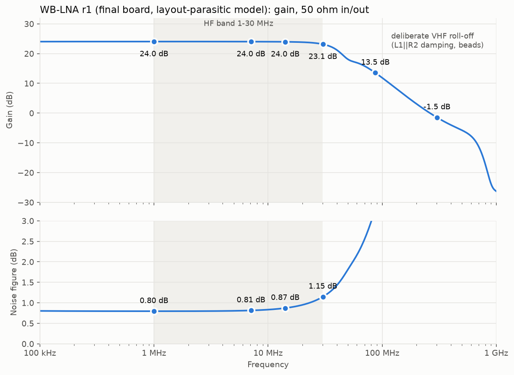
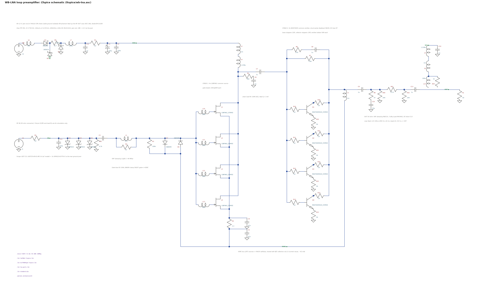

# WB-LNA: HF loop preamplifier

*Concept render: AI-generated (ChatGPT image generation) from the KiCad renders and the enclosure dimensions, with a ruler for scale. It shows the intended build; it is **not** a photograph of a built unit.*

WB-LNA is a single-ended HF (30 kHz – 30 MHz) low-noise amplifier with a high-impedance input. It suits a receiving loop or any other high-Z HF source.
- **Circuit:** 4× LSBF862 common source → 4× NSVF4009 common emitter with shunt-series feedback. The current is reused between the two stages.
- **Output:** a 3 dB π pad into 50 Ω SMA.
- **Power:** +12 V at 42 mA, from **either** the DC jack **or** phantom feed up the RF OUT coax.

## Performance
Simulated on the final board's layout-parasitic model, with a 50 Ω source and load at +12 V.

| | 1 MHz | 7 MHz | 14 MHz | 30 MHz |
|---|---|---|---|---|
| Gain | 24.0 dB | 24.0 dB | 24.0 dB | 23.2 dB |
| Noise figure | 0.80 dB | 0.81 dB | 0.87 dB | 1.14 dB |
| Noise temperature | 59 K | 60 K | 65 K | 87 K |
| Input return loss | 0.2 dB | 0.2 dB | 0.4 dB | 1.5 dB (high-Z input by design) |
| Output return loss | 52 dB | 46 dB | 37 dB | 24 dB |

**Linearity:**
- **Output P1dB:** +10.5 dBm (input −12.6 dBm).
- **OIP3 / IIP3** (−30 dBm/tone, 50 kHz spacing): +30.6 / +6.6 dBm at 7 MHz; +31.3 / +7.9 dBm at 28 MHz.
- **OIP2 / IIP2:** +36.3 / +12.3 dBm.
- **SFDR3 at 7 MHz:** 102 dB in 500 Hz.

**Low end:** flat to about 30 kHz; −3 dB at about 10 kHz.

**Stability:**
- **Tolerance corners:** 256 corners are all stable. They cover choke C and L, bead fits, trace and ground inductance, and gate-to-collector coupling.
- **Loop sources:** against any copper-wire loop into a receiver with |Γ| ≤ 1/3, the worst loop factor is 0.848.
- **Above 88 MHz:** μ ≥ 1.11 and μ′ ≥ 1.06.
- **Kicks:** node and differential kicks decay by ≥ 55 dB within 200 ns.

## How it works
- **Input:** the four LSBF862s run in parallel in common source.
  - Each has its own 100 nH‖60 Ω gate bead, with 100 kΩ gate bias and a BAV99 gate clamp.
  - The sources self-bias through R4/C4.
  - Paralleling four devices cuts en by about 2× against one device. Their combined input capacitance is the price; a loop's own reactance swamps it.
- **Drain:** loaded by 100 Ω AC, fed through a 1 mH choke.
- **Stage 2:** four onsemi NSVF4009 RF BJTs in common emitter.
  - R6/C8 provide shunt-series feedback and R7 the DC bias.
  - Each device has 22 Ω base and 10 Ω collector stoppers and 56 Ω emitter ballast.
- **Current reuse:** the JFET source bus is shared with the BJT collectors through L3, so the whole amplifier draws about 42 mA.
- **Output:** R8/C10 damp VHF, a 3 dB π pad (R40–R42) sets a clean 50 Ω match, and C13 blocks DC.
- **Protection:** a GDT (0.6 pF) plus 3× SP4022 on RF IN to the rear ground post, then VHF damping (L1‖R2).

**Power entry:** the two feeds are diode-ORed (D1/D8). The jack can never put DC on the receiver input, and the coax feed never appears on the jack.
- **Jack:** through a Würth 744222 common-mode choke. Its sleeve reaches board ground only through the choke winding.
- **Coax phantom feed:** L14 100 µH with 1 kΩ across it → L8 1 mH → a bead → 1 µF.
  - The 1 kΩ across L14 kills a series resonance between the two chokes. Without it, S22 has a −10 dB dip near 4 MHz.
- **Shared chain after the OR:** a PTC, a 15 V TVS, a 100 µH / 1 µF LC, then 22 Ω / 220 µF.
- **Differential rejection:** RF on the 12 V lead is rejected by ≥ 101 dB at 0.5–30 MHz, referred to the RF input.
- **Bias-T:** not supplied. Any bias-T rated ≥ 12 V / 100 mA with ≥ 1 kΩ choke impedance across 0.5–30 MHz will do.

## Plots

| plot | what |
|---|---|
| [`1_sparams_stability.png`](plots/1_sparams_stability.png) | S-parameters and μ/μ′ to 3 GHz |
| [`2_hf_gain_nf_match.png`](plots/2_hf_gain_nf_match.png) | HF gain, NF and match |
| [`3_transient_7MHz.png`](plots/3_transient_7MHz.png) | 7 MHz compression and collector swing |
| [`4_feedback_oscillation.png`](plots/4_feedback_oscillation.png) | output→input coupling test: ≤ 3.3 pF is stable, ≥ 10 pF oscillates |
| [`5_longrun_60s.png`](plots/5_longrun_60s.png) | 60 s runs, including power-up from the jack and from the coax |
| [`6_gain_nf_final.png`](plots/6_gain_nf_final.png) | gain and NF, final board |
| [`7_power_entry_chokes.png`](plots/7_power_entry_chokes.png) | power entry and choke impedances |

Plots 1–3, 6 and 7 use the layout-parasitic model. Plots 4 and 5 use the schematic without layout parasitics, because the layout model is too stiff for the long transients.

## LTspice model

`ltspice/wb-lna.asc` is the hand-laid schematic of the final circuit, with every board part. Keep `lsbf862-ltspice.lib`, `nsvf4009sg4-ltspice.lib` and `lna-parts.lib` next to it.
- **Test fixture:** V1 (AC 2) behind RS 50 Ω into RL 50 Ω, so `V(OUT)` is the transducer gain directly. The fixture is for simulation only.
- **Default analysis:** `.noise V(OUT) V1`, which reports NF re 50 Ω. Swap it for `.ac` to get gain.
- **Model fidelity:** checked against the design's reference netlist, it gives identical NF and gain within 0.1 dB.
- **Board copper:** the schematic carries no layout parasitics. The board's parasitic model, which the plots use, adds them.

## Board and ordering

**Board:**
- 92.4 × 42.4 mm, 2 layers, 1.6 mm FR-4, 1 oz copper, solid GND pours on both layers.
- **Enclosure:** Hammond 1591A (= RS PRO 153-3681, 100 × 50 × 25 mm).
- **Mounting:** 4 × M3 holes at 86.2 × 36.2 mm centres.
- **Connectors:** SMA RF IN on the front edge; SMA RF OUT and the 12 V jack on the rear edge.

**JLCPCB fabrication:** upload `jlcpcb/wb-lna_gerbers_drill.zip`.
- 2 layers, 1.6 mm, 1 oz;
- min track/clearance 0.2 mm, smallest via 0.6 / 0.3 mm.

**JLCPCB assembly:** `jlcpcb/BOM_JLCPCB.csv` and `jlcpcb/CPL_JLCPCB.csv`, on the same origin as the gerbers.
- **LCSC numbers:** left blank. Let JLC match parts by MPN or spec.
- **LSBF862:** buy from Linear Integrated Systems.
- **Candidate parts:** rows marked `candidate - verify before ordering` were not checked against a datasheet. They are the Murata beads L4/L5/L9/L10–L13, the R9 PTC and the C1 electrolytic.
- **Hand-solder:** the edge-mount SMAs X1/X2 and the THT jack X3.
- **Rotation:** check every part's rotation in the placement preview. This matters most for SOT-23, the SMA/SMB diodes, the electrolytic and the WE-SL2 choke; pin 1 of the choke is the dotted corner.

**Lands:**
- **J1–J4:** a custom SOT-23 land with shortened inner heels, so the source bus can run under the bodies.
- **Q1–Q4:** onsemi's SC-82FL land.
- **The 2220 chokes:** the B82442T datasheet pattern.

**Install:** the coax shield still carries common-mode RF. Fit a clip-on 31-mix ferrite on the coax at the amplifier.

## Files

| path | what |
|---|---|
| `ltspice/` | `wb-lna.asc` and its three model libraries |
| `images/` | concept render in the enclosure (AI-generated); 3D renders (iso, top), top copper coloured by net, schematic (PNG, SVG) |
| `plots/` | LTspice results (table above) |
| `jlcpcb/` | the gerber + drill zip (Protel extensions, Excellon mm, PTH/NPTH separate, job file), the unzipped files, `BOM_JLCPCB.csv`, `CPL_JLCPCB.csv` |
| `BOM.csv` | the full BOM: qty, designators, value, description, manufacturer, MPN, footprint, status |
| `kicad/` | `wb-lna.kicad_pcb`, the project, the custom footprint library `wblna.pretty`, the DRC report |
| `wb-lna.step` | 3D board model. The L6 body is a scaled stand-in. |

**Not claimed:** any surge/ESD rating or measured performance. All figures are simulation.
