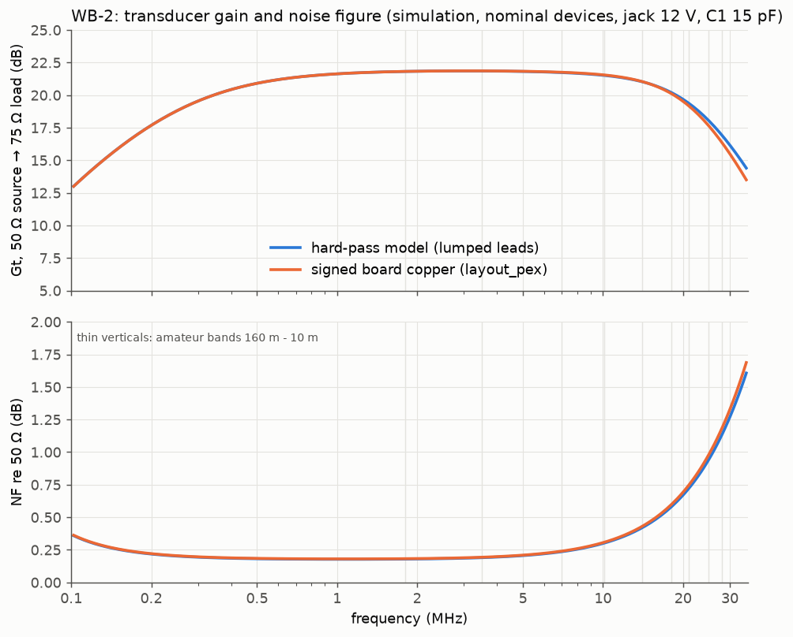
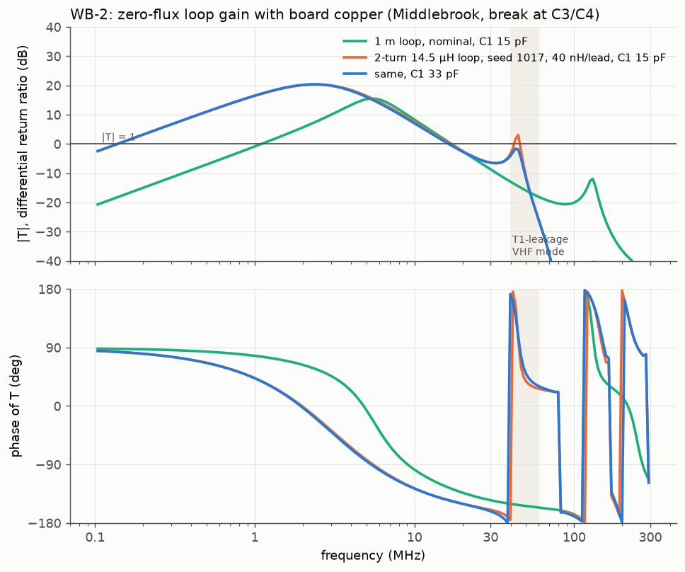

# WB-2: zero-flux loop amplifier

*Concept render: AI-generated (ChatGPT image generation) from the KiCad renders and the enclosure dimensions, with a ruler for scale. It shows the intended build; it is **not** a photograph of a built unit.*

WB-2 is a balanced HF (0.1–30 MHz) amplifier for small receiving loops, in the Wellbrook ALA1530 class.
- **Feedback:** the loop is held near short circuit by lossless transformer feedback.
- **Parts:** catalog parts only, so there is no hand-wound transformer and no trimmer.
- **Power:** +12 V from either a DC jack or phantom feed up the coax.
- **Output:** 75 Ω F jack.

| | 1–7 MHz | 14 MHz | 21 MHz | 30 MHz |
|---|---|---|---|---|
| Gain (50 Ω source → 75 Ω load) | 21.6–21.8 dB | 21.1 dB | 19.0 dB | 15.8 dB |
| Noise figure (re 50 Ω) | 0.18–0.24 dB | 0.41 dB | 0.77 dB | 1.27 dB |

- **Linearity:** SFDR3 is 108–112.6 dB in 500 Hz.
- **Supply:** 75 mA at 12 V. The board operates from 11 to 15 V and switches itself off above about 17 V. It survives 24 V sustained.
- **Source:** these figures are simulation with nominal devices, using the layout-parasitic model of this board.

## How it works

**A small loop is an inductive source.** Its EMF rises with frequency, and so does its reactance, so the **short-circuit current** is flat with frequency. The Wellbrook idea is to amplify that current while holding the loop terminals near zero volts. The loop then carries almost no net signal flux, which gives the topology its "zero-flux" name.

**The hold is done with transformer feedback, not resistors.** Transformers add no thermal noise, so the feedback costs essentially nothing in noise figure.
- **T1 (Coilcraft WB16-6T)** senses the loop voltage. Its centre-tapped secondary drives the two gate buses, GA and GB.
- **The input stage** is two banks of 4× LSBF862 in common source, one bank per half.
- **T3/T4 (2× WB36-1)** carry the feedback. Each half's source current flows through the 25 µH winding of one of them; the 900 µH winding sits across the loop, a 6:1 turns ratio. It is phased so the returned current opposes the loop voltage.
- **Result:** with high loop gain, the loop sees a near-short, and the drain current is a faithful copy of the loop's short-circuit current.

**Bias:** each half runs at 33.8 mA.
- An op-amp current sink sets it, replacing the original's verostat. LM358B and BC817-25 force V(E) = 0.50 V across 14.7 Ω.
- The sink sits behind a 1 mH choke, so its noise never reaches the summing node.
- A TL431 sets all the bias references, so the currents don't depend on the supply.
- The gate buses sit at 1.50 V through T1's centre tap. They are clamped by antiparallel BAV99s that see zero DC, so they add no leakage noise.

**Cascode and output:**
- **Cascode:** 2× 4 LSBF862 in common gate, with 10 Ω gate stoppers. The gates sit at VBB = 5.0 V, locally bypassed. A JFET cascode has no base current, so there is no partition noise.
- **Output:** push-pull into T2 (WB5-1T), with the centre tap fed from VDD. C16 blocks DC from the coax, because the coax may carry phantom power.

**Stability at VHF.** The worst stability case is a VHF mode at 43–52 MHz through T1's leakage inductance. It shows up with multi-turn or high-inductance loops, for example 14.5 µH with 40 nH leads.
- **Snubber:** R3 + C1 across the loop pins sets the margin.
- **C1 = 15 pF (baseline):** 4° phase margin on such a loop.
- **C1 = 33 pF (option):** 36° phase margin.
- **Choosing:** fit 15 pF for 1 m-class single-turn loops and 33 pF for big or multi-turn loops. `plots/2_vhf_loopgain.png` shows the Middlebrook loop gain at the C3/C4 pads.

**Power entry:** two feeds, diode-ORed, then a shared protection chain.
- **Feeds:** the DC jack through a Würth 744222 common-mode choke, or +12 V phantom up the coax through L6‖R27, a 1 mH choke and a bead.
- **Protection chain:**
  - a 200 mA PTC;
  - an SMBJ26A TVS;
  - a TPS26621 eFuse as an over-voltage cut-off (17.16 V rising, 16.0 V falling);
  - a PMEG4020 output clamp;
  - a 100 µH / 1 µF LC, then 4.7 Ω / 220 µF.

## Plots

## LTspice model

`ltspice/wb2.asc` is the complete simulation model: 240 elements, every board part plus the layout lead inductances.
- **Supporting files:** `sp4022.asy` (TVS symbol), `lsbf862-ltspice.lib` and `wb2-parts.lib`. Keep them next to the `.asc`.
- **How it was made:** the schematic is generated from the design's own netlist, and LTspice's netlist of it was checked against that netlist element by element (`../tools/net_compare.py`). The simulated response is identical.
- **Coupled windings** are LTspice `ind2` inductors (the dot is the first node) with K statements at k = 0.9995.
- **Default analysis:** `.ac` with a 50 Ω generator (VSIG, RS) across the loop posts into a 75 Ω receiver.
  - `V(out)` is the load voltage.
  - Transducer gain is `20·log|V(out)| + 10·log(200/75)` dB.
- **Noise:** swap the `.ac` for `.noise V(out) VSIG dec 30 10k 60Meg`. `inoise` is then referred to the 50 Ω source.
- **Loop gain:** VBRA/VBRB are 0 V break points. Make them AC sources for Middlebrook V/I injection.
- **Behavioural blocks** (stated on the sheet): the op-amp, the TL431 and the eFuse.

## Board and ordering

**Board:**
- 96 × 76 mm, 2 layers, 1.6 mm FR-4, 1 oz copper, solid GND pours on both layers.
- **Enclosure:** Hammond **1554F2GY** (IP66). The board mounts on the box's M3 inserts (77 × 68 mm) on 10 mm standoffs; the corner bites clear the lid-screw columns.
- **Connectors:** all panel-mounted and wired to the board.
  - Left wall: loop posts J1/J2 and the ground post J3.
  - Right wall: F jack J4 (RG-179 pigtail ≤ 50 mm) and DC jack J5.
- **Mechanical drawing:** `docs/wb2_mechanical.pdf` (rev C) gives the wall-hole positions, checked against the connector makers' drawings. It is not a drilling template until the box datums are measured.
  - **Left wall:** Cliff CL1505 posts (13.3 mm collars, 7 mm keyed holes) at 19.05 mm pitch, so a dual 4 mm plug fits LOOP A/B.
  - **Right wall:** the 222114-10 F jack mounts from the rear (12.9 mm flange inside). The 721AU's 14.3 mm body sits inside the wall, clear of the lid-screw column.
  - **721AU nut:** its bushing is only 4.6 mm long, so check nut engagement on the 3 mm wall and counterbore from inside if it is short.

**JLCPCB fabrication:** upload `jlcpcb/wb2_gerbers_drill.zip`.
- 2 layers, 96 × 76 mm, 1.6 mm, 1 oz;
- min track/space 0.2 mm, min drill 0.2 mm (the U3 thermal vias);
- HASL-LF or ENIG.

**JLCPCB assembly** (top side, optional): upload `jlcpcb/BOM_JLCPCB.csv` and `jlcpcb/CPL_JLCPCB.csv`.
- **Contents:** 115 SMD parts. The CPL uses the gerbers' absolute origin, in mm.
- **LCSC numbers:** the column is left empty. Match parts in JLC's BOM tool by manufacturer/MPN. Generic passives can be any vendor to the stated dielectric and voltage.
- **Rotation:** check every part's rotation in the placement preview. This matters most for SOT-23, VSON-10, SOD-123F and the Coilcraft WB parts. Pin 1 of the WB transformers is the dot.
- **Supply your own:** the LSBF862s, Vgs-matched within each bank, and probably the Coilcraft transformers.

**Hand assembly:**
- C19 is a 220 µF radial (THT). Mind the polarity.
- The panel wiring and the RG-179 pigtail, laced at its two holes.
- D12/D13 are DNP evaluation pads.

## Files

| path | what |
|---|---|
| `ltspice/` | `wb2.asc`, `sp4022.asy`, `lsbf862-ltspice.lib`, `wb2-parts.lib` |
| `images/` | concept render in the enclosure (AI-generated); 3D renders (iso, top, bottom); copper coloured by net (top, bottom); test-pad map; mechanical drawing; schematic (PNG, SVG) |
| `plots/` | gain/NF (hard-pass model vs board copper); VHF loop gain with C1 15 vs 33 pF |
| `jlcpcb/` | the gerber + drill zip, the unzipped files (Excellon in mm, PTH and NPTH separate, with maps), `BOM_JLCPCB.csv`, `CPL_JLCPCB.csv` |
| `BOM.csv` | the full BOM: designators, value, description, manufacturer, MPN, footprint, status (specified / generic / THT / panel / DNP / mechanical) |
| `kicad/` | `wb2.kicad_pcb`, the project, footprint libraries (`wb2.pretty`, `wblna.pretty`), the custom 3D bodies (`wb2.3dshapes`), netlist and footprint tables, DRC report (0 unconnected, 0 clearance) |
| `docs/BRINGUP.md` | first-board bring-up procedure: power-up, bias, the transformer-phasing check, the stability matrix for the C1 decision |
| `docs/SOURCING.md` | lifecycle and sourcing table |
| `docs/README-LAYOUT.md` | the floorplan and the reasoning behind the placement |
| `docs/testpoints.md`, `docs/*.pdf` | test-pad map; assembly, copper and mechanical drawings |
| `wb2.step` | 3D board model. The Coilcraft and pigtail bodies are simple boxes. |

The docs mention numbered design reviews (review-06, -08 and so on). Those were internal review rounds of the schematic and layout; their conditions are folded into these documents.

**Not claimed:** any surge/ESD rating, measured RF performance or thermal qualification. All figures are simulation.
